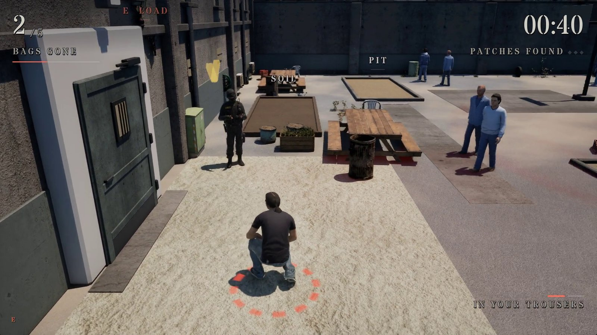
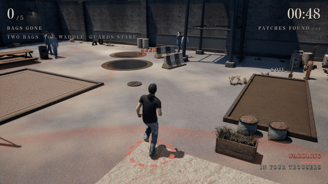
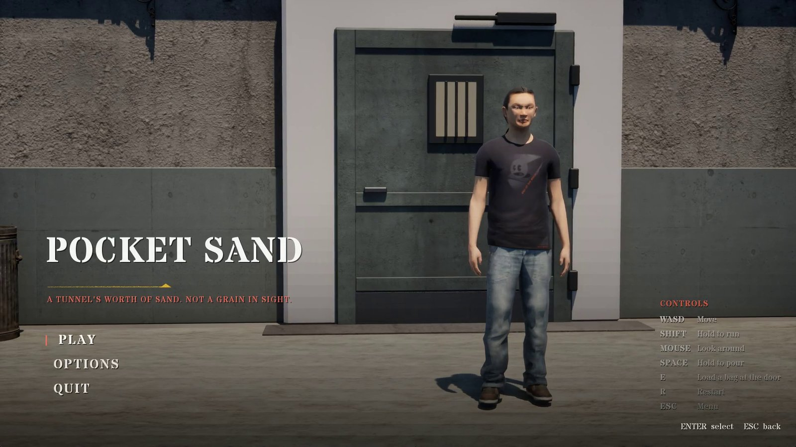
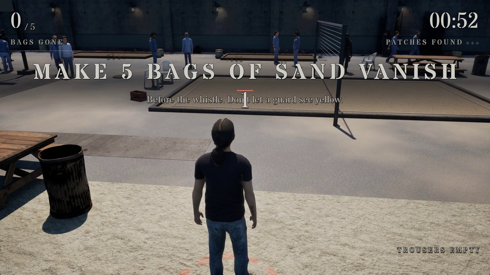
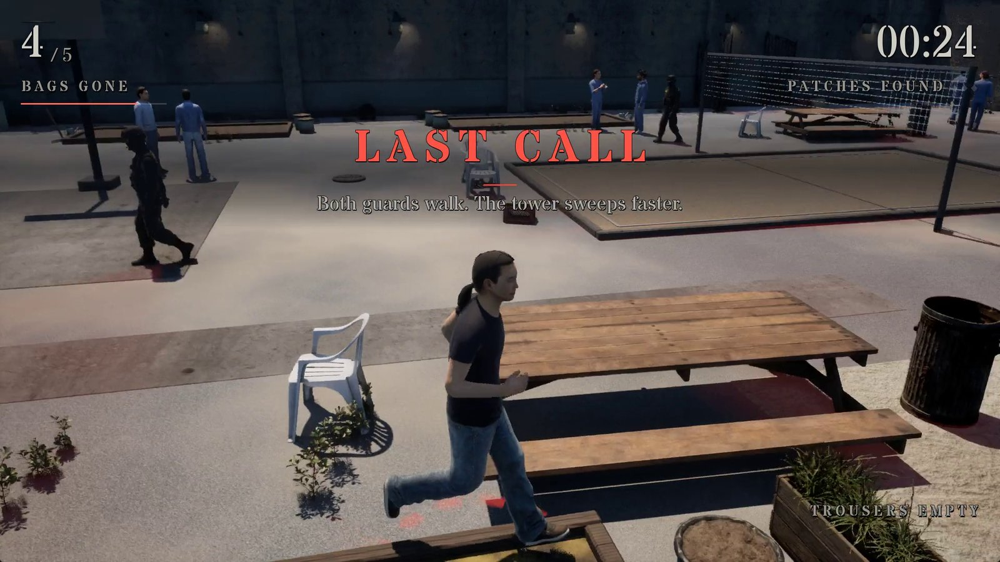
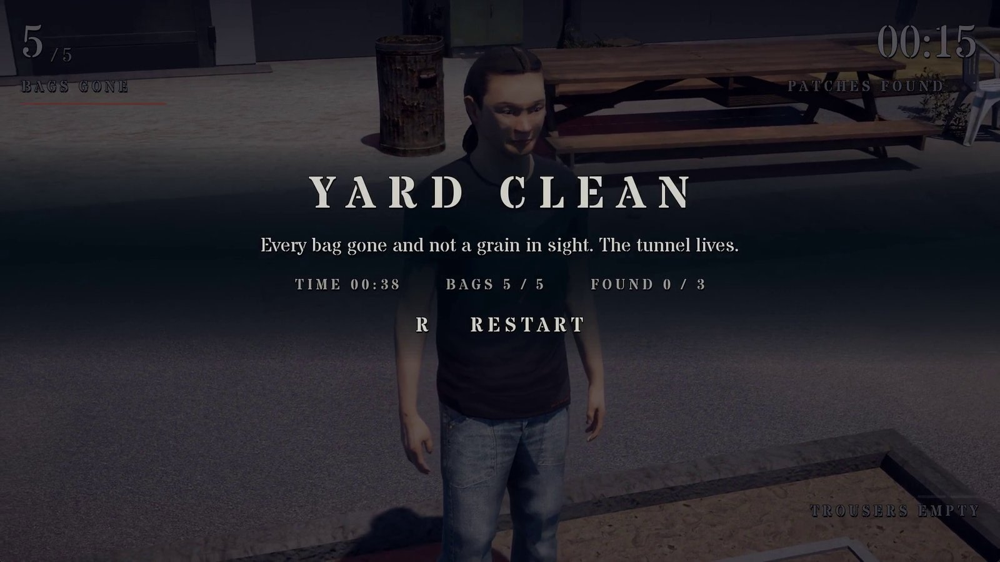

# Grain by Grain

*A tunnel's worth of sand. Not a grain in sight.*

A third-person crowd stealth game made in **Unreal Engine 5.8** with gameplay written entirely in C++.

The project still uses its working title, **Pocket Sand** (`PocketSand.uproject`), which you'll see on the start screen.

## About

You've dug a tunnel, and now the sand has to go. Smuggle it out in your trouser bags and pour it into the prison yard without the guards noticing. Crowds grind your trail into the gravel, soil beds fill up, the volleyball court spills, and every yellow patch a guard finds makes that corner of the yard more dangerous.

**Goal:** Empty every bag of tunnel sand before the whistle. Lose if guards find too many yellow patches, catch you pouring, or the whistle blows with sand still in your bags.

**[Watch the full gameplay video (MP4, with sound)](media/gameplay.mp4)**

## Controls

| Key | Action |
|---|---|
| W A S D | Move |
| Shift (hold) | Run |
| Mouse | Look around |
| Space or left mouse (hold) | Pour sand |

## Highlights

- Every surface trades differently: soil fills up, the court spills, the gravel hides
- Inmate crowds are moving cover that wears your trail away
- Guards with suspicion and memory of where they found sand
- Motion-captured cast from the Microsoft Rocketbox library

## Screenshots

| | |
|---|---|
|  Start screen |  Make five bags of sand vanish |
|  Last call |  Yard clean: every bag gone |

## Play it

1. Install **Unreal Engine 5.8** (Epic Games Launcher) and **Visual Studio 2022** with the *Game development with C++* workload.
2. Download `GrainByGrain-UE5.8-project.zip` from the [Releases](../../releases) page and unzip it.
3. Double-click `PocketSand.uproject` and say **Yes** when it asks to build the modules.
4. Press **Play** in the editor, or right-click the `.uproject` and choose *Launch game*.

This repository holds the source and config. The levels, art and audio (`Content/`) are only in the release zip, because they are too large for git.

## Project layout

| Folder | What's in it |
|---|---|
| `Source/PocketSand/` | all gameplay code (C++) |
| `Config/` | engine, input and game settings, including tuning values |
| `media/` | screenshots for this page |

## Credits and licence

Third-party assets (all free to use and redistribute) are listed with their authors and licences in [CREDITS.md](CREDITS.md). The licence and notice files that came with them are in [licenses/](licenses/) and in the release zip.
The code and original content are **all rights reserved**: see [LICENSE](LICENSE).
